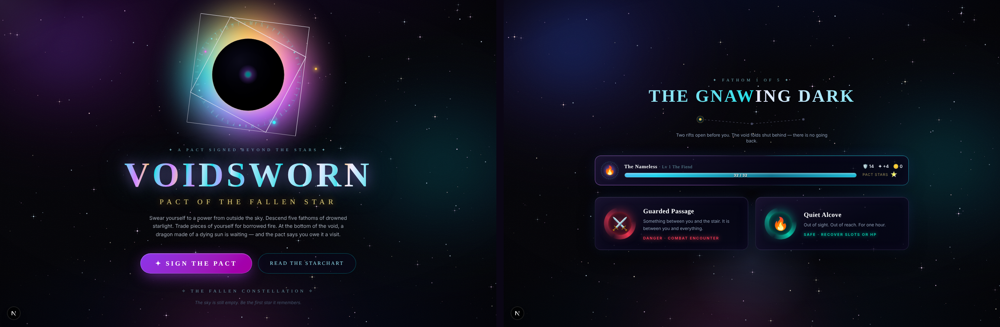

# VOIDSWORN — Pact of the Fallen Star

**Play it:** https://somersetnomad.github.io/Voidsworn/

A cosmic roguelite of pact magic, eldritch invocations and dark bargains. Swear yourself to a power from beyond the sky, fall through five fathoms of drowned starlight, and face Vermithrax — a dragon made of a dying sun — at the bottom of the void.



## Features

- **Four patrons** — the Fiend, the Great Old One, the Archfey and the Hexblade, each with a passive and a once-per-fight power
- **Pact magic** — a few powerful spell slots that all recharge
- **Eldritch Invocations** — carve your build as you level up
- **Dark Bargains** — trade pieces of yourself for power between fathoms
- **Telegraphed boss** — Vermithrax gathers flame a turn before the breath: brace, evade, or burn
- **Runs entirely in the browser** — no server or database; plays straight from GitHub Pages

## Tech

Next.js 16 (static export) · React 19 · TypeScript · Tailwind CSS 4 · shadcn/ui

## Run it locally

```bash
bun install            # or: npm install
bun run dev            # http://localhost:3000
bun run build          # static site in ./out
```

Every push to `main` builds the site and deploys it to GitHub Pages via `.github/workflows/deploy.yml`.

## Project layout

- `src/lib/game/` — the game engine: content, dice and combat math, state reducer
- `src/components/game/` — the screens, plus `Cosmos.tsx` (the animated starfield backdrop)
- `scripts/simulate.ts` — headless balance simulator
